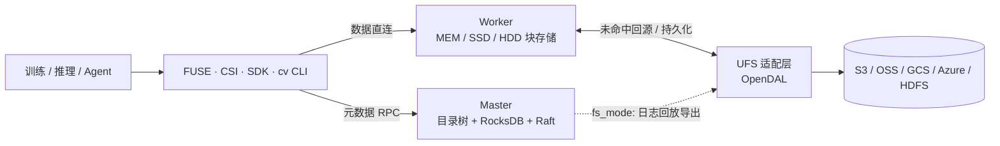

# Runix FS 快速学习

面向第一次接触本仓库、想在一小时内建立整体认知的人。分三块:**解决什么问题**、**怎么解决**、**上生产还缺什么**。

依据是本仓库源码(基线 Curvine `7d476508`,2026-10-21 迁入)和上游文档。文中标注:

- **代码**:已在源码核对,附 `文件:行号`;
- **上游称**:上游 README / 博客的说法,本仓库没有复测;
- **推论**:由代码推出,还没有用测试验证。

> 先纠正一个常见说法:Runix FS **不是 JuiceFS 的衍生**,它 fork 自 [Curvine](https://github.com/CurvineIO/curvine)
> (Rust 实现,OPPO 团队发起,CNCF Sandbox 项目)。JuiceFS 是同一赛道的竞品,见 1.4。

## 0. 一句话

在便宜、无限容量但「不像文件系统」的对象存储(S3 / OSS / GCS ...)上面,铺一层**带分布式缓存的 POSIX 文件系统**,
让 AI 训练、推理、Agent 工作区像用本地盘一样用对象存储,而数据的最终归宿仍是对象存储。

## 1. 它解决什么问题

### 1.1 场景

| 场景 | 痛点 |
|---|---|
| 大模型训练读数据集 / 写 checkpoint | GPU 很贵,数据从 S3 读得慢,GPU 就空等;checkpoint 几十 GB,写慢拖慢训练 |
| 模型分发(推理冷启动) | 几百个节点同时从 S3 拉同一份权重,S3 带宽和请求费都吃不消 |
| AI Agent 工作区(上万个 Pod) | 每个 Agent 要一个可写目录,跑 `git` / `npm` / 编辑器,全是小文件和元数据操作 |
| 数据湖 / OLAP | 存算分离后,每次查询都去对象存储取热数据 |

### 1.2 为什么直接用对象存储不行

对象存储是「key → 整个对象」的接口,不是文件系统:

1. **慢**:每次请求几十毫秒;小文件、`ls`、`stat` 这类元数据操作要一次次走网络。
2. **语义缺**:没有真正的目录、rename(只能 复制 + 删除)、追加写、随机写、文件锁;很多工具(`git`、编译器、Python 包管理)直接用不了。
3. **贵**:按请求次数计费,训练反复读同一批数据,每一遍都付请求费和流量。

所以需要一层东西:**往上给 POSIX 语义,中间用缓存把热数据放到计算节点旁边,往下仍以对象存储为持久层**。

### 1.3 「是不是只有它能解决?」不是

这一层有很多实现(见 1.4)。Runix FS / Curvine 的差异在**组合**,不是独占某一项能力:

- **桶里的数据按原路径原样存放**(文件路径与对象 key 1:1,上游称)。集群停了,桶里的文件照样能被别的工具直接读;
  对比 JuiceFS 社区版把文件切成 chunk / slice / block 存,桶里看不到原文件。
- **两种挂载模式可选**(代码,见 2.3):`cache_mode` 以桶为准、写直通;`fs_mode` 先写集群、异步落桶,写得快但最终一致。
- **Rust + Tokio**:没有 GC 停顿,尾延迟更稳(上游称约 100μs 级延迟、10 万级 QPS)。
- **K8s 原生**:CSI 驱动创建 PVC 只是在共享命名空间里 `mkdir`,不调云厂商 API,毫秒级(上游称),适合上万个 Agent Pod。
- 元数据用 Raft 复制;上游称单集群 50 亿小文件。

### 1.4 竞品对照

| 方案 | 形态 | 桶里的数据 | 缓存 / 性能 | 适合 |
|---|---|---|---|---|
| **Runix FS / Curvine** | 自建集群:Master(Raft) + Worker 缓存 + FUSE/CSI/SDK | 原路径原样(1:1) | 内存/SSD/HDD 分布式缓存,短路本地读 | 训练、模型分发、Agent 工作区 |
| JuiceFS | 自建:元数据引擎(Redis/TiKV/MySQL…) + 对象存储 | 切块存储,社区版不能直接读已有对象 | 客户端本地缓存(分布式缓存见其企业版文档) | 通用 POSIX、强一致 |
| Alluxio | 自建缓存层(Java),Master + Worker | 原路径(它本身就是 UFS 之上的缓存) | 分布式缓存 | 大数据 / AI 读加速 |
| Amazon S3 Files | AWS 托管,NFS v4.2 挂载 S3 桶(2026-04 GA) | 原样留在 S3 | 托管,按用量付费 | 不想自运维、要 NFS 的 AWS 用户 |
| Mountpoint for Amazon S3 | AWS 开源 FUSE 客户端(Rust) | 原样 | 主要优化大文件顺序读、新建写 | 只读数据集、写新文件,不需要完整 POSIX |
| FSx for Lustre | AWS 托管 Lustre,可关联 S3 | 导入 / 导出 | 托管并行文件系统,吞吐高、成本高 | HPC、大规模训练 |
| 3FS(DeepSeek) | 自建 SSD + RDMA 集群,FoundationDB 元数据 | 不以对象存储为持久层 | 极致吞吐 | 自有机房的大规模训练 |

简单说:**要托管、省心选 S3 Files / FSx;要极致训练吞吐、有自己的机房选 3FS;要通用强一致 POSIX 选 JuiceFS;
要自建、数据留在桶里原样可读、同时服务训练和上万 Agent 的,是 Curvine 这一类的位置**。

竞品一栏是各家公开文档的概括,选型前以对方最新文档为准。

## 2. 它怎么解决

### 2.1 架构:元数据和数据分两条路



| 角色 | 代码位置 | 职责 |
|---|---|---|
| Master | `curvine-master`、`crates/metadata/curvine-raft` | 目录树、inode、块位置;Raft 复制;挂载表、TTL、配额淘汰、导出任务 |
| Worker | `curvine-worker`、`crates/adapters/curvine-storage-local` | 按块存数据,多级目录(MEM/SSD/HDD/DISK,可选 SPDK) |
| Client | `curvine-client`、`crates/client/*` | 统一文件系统:决定读缓存还是读桶、写集群还是写桶 |
| FUSE / CSI | `curvine-fuse`、`curvine-csi`(Go) | 挂成本地目录 / K8s PVC |
| UFS | `crates/adapters/curvine-ufs-opendal` | 对接各家对象存储 |
| Job / Transfer | `curvine-master/src/master/job`、`crates/server/curvine-data-transfer` | 预热(load)、导出(export) |

要点:**Master 只管「文件在哪」,字节直接在客户端和 Worker 之间走**,Master 不会成为数据带宽的瓶颈。

### 2.2 读一个文件发生了什么

入口 `UnifiedFileSystem::open`(代码,`crates/client/curvine-unified-fs/src/unified/unified_filesystem.rs:1102`):

```text
open(path):
  路径不在任何挂载点下        -> 直接读 Curvine 自己的文件
  在挂载点下:
    get_cv_reader()             # :491
      fs_mode    -> 集群里有数据就读集群(读失败可回退到桶)
      cache_mode -> 先判缓存是否有效 check_cache_validity()   # :471
                    有效条件:有 UFS mtime、没过期、桶里还在;
                    挂载时开了 --read-verify-ufs 才再去比对桶里的 len + mtime
    命中  -> 从 Worker 读(本机有 Worker 时走短路本地读)
    未命中 -> 若开了 auto_cache,后台提交预热任务 async_cache()   # :541
             前台直接读桶,不等预热
```

### 2.3 写一个文件发生了什么:两种挂载模式

入口 `open_with_opts`(代码,同文件 `:750`)。`cv mount` 默认 `--write-type fs_mode`
(代码,`curvine-cli/src/cmds/mount.rs:64-69`)。

| | `cache_mode`(读多写少) | `fs_mode`(默认,写多) |
|---|---|---|
| 写到哪 | 先删集群里的旧缓存,**直接写桶**;可选同时镜像一份进缓存(`WriteCacheWriter`) | **只写集群**。若改的是只在桶里的已有文件,先整份拷进集群再写 |
| 什么时候算写完 | 桶写成功 | 集群写成功即返回,**桶是之后异步补的** |
| 怎么落桶 | 已在桶里 | Master 的 Leader 回放 Raft 日志,`complete_file` 时提交导出任务 `submit_export_task`(`ufs_loader.rs:90,144`),单独记一个 `ufs_applied` 水位(`journal_loader.rs:237`) |
| rename | 走桶 | 桶支持就直接 rename;**S3/OSS 这类不支持的,变成删除 + 整份重新导出**(`ufs_loader.rs:171`) |
| TTL 到期 | 删除(`TtlAction::Delete`) | 只释放缓存、桶里保留(`TtlAction::Free`)(`mount.rs:389-393`) |
| 外部直接改了桶 | 读时按 mtime 判断 | 要跑 `cv mount resync <cv_path>` 重新对齐 |

一句话:**`cache_mode` 桶是唯一真相;`fs_mode` 集群先是真相,桶最终一致**。

### 2.4 「耗」在哪,分别怎么省

直接用对象存储,时间主要耗在四处:**每次请求的网络延迟、元数据操作、跨网络搬数据、冷读**。对应手段:

| 耗在哪 | 手段 | 默认值 / 出处 |
|---|---|---|
| 元数据(`ls` / `stat` / `open` / `rename`) | 目录树在 Master 内存里,RocksDB 持久化,不走对象存储;FUSE 内核缓存属性和目录项 | `attr_timeout` / `entry_timeout` 1s(`etc/curvine-cluster.toml`) |
| 大文件吞吐 | **按块切分**分散到多个 Worker;块内按 chunk 流水线传输,多个 chunk 同时在途;单文件可多路并行读 | 块 128MB,chunk 128KB × 8,并行读默认 1、上限 8(`client_conf.rs:365-390、268-280`) |
| 顺序读 | 检测连续读,自动开预读;判定为随机读就关预读,避免浪费 | `read_detector.rs:187` |
| 跨网络搬数据 | **短路读写**:客户端和 Worker 在同一台机器时直接读写本地块文件,不走网络 | `short_circuit = true`(`client_conf.rs:388`) |
| 冷读 | 首次未命中时前台读桶、后台预热(`auto_cache`);也可用 `cv load` 提前预热 | `unified_filesystem.rs:1137` |
| 写延迟 | `fs_mode` 写进集群就返回,落桶异步 | 2.3 |
| 节点上的缓存放哪 | Worker 有多级目录,按请求的存储类型轮询选目录,不够时退回 DISK | `policy.rs:56` |
| 缓存满了 | Master 按 LRU/LFU 淘汰(超过 80% 开始,降到 60% 停) | **默认关闭**,`master_conf.rs:361-366` |
| GC 停顿 | Rust,无 GC | 上游称 |

说明一点:README 写的「热数据在 MEM → SSD → HDD 间自动升级」,**在本仓库代码里没找到对应的迁移逻辑**。
存储类型在写入时选定(`--storage-type`,默认 DISK)。是否另有机制,要读 `curvine-worker` 再确认。

### 2.5 30 分钟读代码路线

1. `specs/architecture.md`:模块地图(5 分钟)。
2. `crates/common/curvine-model/src/mount.rs:555-600`:`WriteType` 两种模式(3 分钟)。
3. `crates/client/curvine-unified-fs/src/unified/unified_filesystem.rs`:`open`(1102)→ `get_cv_reader`(491)→
   `check_cache_validity`(471);写看 `open_with_opts`(750)(10 分钟)。
4. `crates/client/curvine-client-core/src/block/block_reader_local.rs`:短路读长什么样(3 分钟)。
5. `curvine-master/src/master/journal/journal_loader.rs:237` + `ufs_loader.rs`:fs_mode 怎么异步落桶(5 分钟)。
6. `crates/common/curvine-config/src/client_conf.rs:365`:所有客户端默认值一屏看完(2 分钟)。
7. `curvine-master/src/master/quota/`:淘汰(2 分钟)。

动手:编译和集群冒烟按 `specs/architecture.md` 的「Development and test gates」,在 Linux 上做(需要 RocksDB、protobuf、FUSE)。
本地起集群用 `build/bin/local-cluster.sh`,挂载用 `cv mount <ufs_path> <cv_path> --write-type fs_mode|cache_mode`。
## 3. 现在还有哪些问题,上生产要补什么

### 3.1 已经看到的问题

| # | 问题 | 依据 | 影响 |
|---|---|---|---|
| 1 | **集群内部 RPC 和 Web 没有认证 / TLS** | 代码:在 `crates/core/rpc`、`net`、master/worker handler 里没找到认证或 TLS 实现;`specs/architecture.md` 也要求保持内网 | 谁能连上端口谁就能读写、改配置。只能放在受信内网 |
| 2 | **权限只是 POSIX uid/gid,不是租户隔离** | 代码:`curvine-fuse/src/fs/curvine_file_system.rs` 的权限检查信任客户端传的身份 | 多个客户 / 多个 Agent 共用一个集群时互相看得见 |
| 3 | **fs_mode 先确认后落桶,默认 1 副本** | 代码:写入集群即返回,Leader 回放日志异步导出(2.3);`replicas: 1`(`client_conf.rs:372`) | 推论:数据还没导出时,唯一那份所在的盘坏了就会丢。需要故障注入测试确认 |
| 4 | **导出失败的可见性** | 代码:单个导出任务超时默认 20 分钟(`journal_conf.rs:299`);有 `ufs_applied` 水位指标 | 桶落后多少、哪些文件没落桶,需要明确的告警和补偿流程 |
| 5 | **cache_mode 默认不对桶做校验** | 代码:`--read-verify-ufs` 默认 false,挂载 TTL 默认 7d(`mount.rs:48-53`) | 有人绕过集群直接改桶,可能一直读到旧数据 |
| 6 | **S3 上的 rename 很贵** | 代码:不支持 rename 的存储走 删除 + 整份重导出(`ufs_loader.rs:171`) | 对大目录做 rename 等于整目录重传 |
| 7 | **缓存淘汰默认关闭,也没有自动分层** | 代码:`enable_quota_eviction: false`;未找到 MEM/SSD/HDD 间迁移逻辑(2.4) | 盘写满后写入失败;热数据不会自己挪到快盘 |
| 8 | **元数据是单个 Raft 组** | 推论:`curvine-raft` 是单组实现,全部写元数据走一个 Leader;`curvine-mds` + FoundationDB 是另一条路,默认关 | 50 亿文件、上万 Agent 是上游的测试结论,我们没复测 |
| 9 | **上游说的 S3 协议网关不存在** | 代码:工作区里没有 S3 网关 crate(上游 PR #798 删除);只有 S3 **后端**适配器 | 对外不能写「兼容 S3 协议访问」 |
| 10 | **没有 Runix 自己的发行包和性能数据** | `specs/roadmap.md` 阶段 1 未做;README 的性能数字全部是上游的 | 不能对外承诺性能或 SLA |

### 3.2 上生产的必要条件

按「先能安全跑,再能放心用,最后能卖」排:

| 阶段 | 必要因素 | 验收标准 |
|---|---|---|
| **能安全跑** | 网络隔离:Master/Worker/Web 端口只对集群内和指定客户端开放 | 外网扫描不到端口;未授权节点连不上 |
| | 可复现的构建与镜像:锁定源码 SHA 和工具链,出 SBOM | 同一 SHA 两次构建结果一致;镜像在 Runix 自己的 registry |
| | 部署与升级:Master 3 节点 Raft、滚动升级、回滚演练 | 升级期间读写不中断;回滚后数据一致 |
| **能放心用** | 持久性:关键挂载 ≥2 副本,或用 cache_mode;明确 fs_mode 的「未落桶窗口」 | 杀 Worker / 拔盘 / 杀 Leader 的故障注入测试不丢已确认数据,或丢失范围有文档 |
| | 落桶监控:`ufs_applied` 与 `applied` 的差、导出失败数、最老未落桶时间 | 超阈值告警;有重试和人工补偿手册 |
| | 一致性约定:每个挂载写清用哪种模式、外部能不能改桶、何时跑 `resync` | 外部改桶后的行为有测试 |
| | 容量:开启并调好淘汰(水位、策略),盘满的行为有测试 | 写满不雪崩,淘汰后命中率可接受 |
| | 备份恢复:Master 元数据快照恢复,与桶里的数据恢复分开演练 | 恢复时间和数据范围有实测记录 |
| | 观测:用自带指标 + Grafana(`etc/grafana`)建 SLO、告警、容量预测 | 命中率、P99 延迟、落桶延迟、Raft 健康都有告警 |
| | 兼容性回归:FUSE 的 create/read/write/rename/delete/fsync、CSI 生命周期、重启恢复 | 每次发布都跑;POSIX 用例(上游称过 LTP 1129 项)在我们环境复测 |
| | Runix 自己的性能基准:记录硬件、SHA、负载、时长、原始数据 | 替换掉 README 里的上游数字 |
| **能卖(多租户)** | 认证与 TLS:集群内 mTLS,客户端用服务端签发的身份 | 跨租户访问被拒的对抗测试 |
| | 租户隔离与配额:命名空间、Worker 直连数据的鉴权、按字节的强制配额 | 并发写、超额、资源耗尽测试 |
| | 计量与计费:与指标分开的、可去重、可对账的用量流水 | 重放、部分成功、重试不重复计费 |

`specs/roadmap.md` 和 `specs/commercial-service.md` 里有更细的阶段划分和测试清单。

## 4. 术语

| 术语 | 含义 |
|---|---|
| UFS | Under File System,底层持久存储(S3、OSS、HDFS…) |
| `cv` | 命令行工具;`cv mount` 挂载、`cv load` 预热、`cv mount resync` 重新对齐 |
| block / chunk | 文件切成块(默认 128MB)分布到 Worker;块内按 chunk(128KB)流式传输 |
| short circuit | 客户端与 Worker 同机时直接读写本地块文件 |
| cache_mode / fs_mode | 挂载的两种写模式,见 2.3 |
| TTL Free / Delete | 到期只清缓存 / 连数据一起删 |
| applied / ufs_applied | 元数据回放到哪 / 落桶回放到哪,两者之差就是桶落后的程度 |

## 参考

- 上游:[Curvine](https://github.com/CurvineIO/curvine)、[文档](https://curvineio.github.io/docs/Overview/instroduction)
- JuiceFS:[架构](https://juicefs.com/docs/community/architecture)、[存储格式说明](https://juicefs.com/en/blog/engineering/design-metadata-data-storage)、
  [FAQ:不能直接读已有对象](https://github.com/juicedata/juicefs/blob/main/docs/en/faq.md)
- Amazon S3 Files:[挂载文档](https://docs.aws.amazon.com/AmazonS3/latest/userguide/s3-files-mounting.html)
- 本仓库:`specs/architecture.md`、`specs/roadmap.md`、`specs/commercial-service.md`

Runix Lab 新增文档,2026-10-22。
