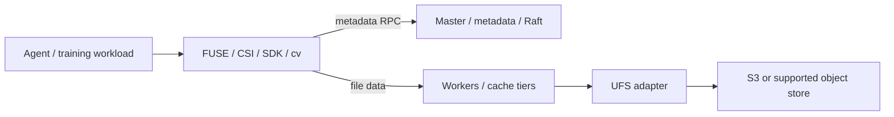

# Runix FS architecture baseline

Baseline: Curvine `7d476508e2cd608a1aaaf7837999f52ab633811e`.
Evidence is source inspection, not production runtime validation.

## Module map

| Area | Source | Responsibility |
| --- | --- | --- |
| Workspace | `Cargo.toml` | Rust crates; default-members omit integration harness and LanceDB |
| Contracts | `crates/common/curvine-{fs,storage,ufs}-api` | Interface boundaries between clients, storage and UFS |
| Core | `crates/core` | Runtime, networking, RPC, I/O, allocation, metrics and fault injection |
| Metadata | `curvine-master`, `curvine-mds`, `crates/metadata/curvine-raft` | Namespace/metadata services and replicated state |
| Storage | `curvine-worker`, `crates/adapters/curvine-storage-*` | Data serving, local cache and optional SPDK adapter |
| Object store | `crates/adapters/curvine-ufs-opendal`, `curvine-ufs` | Underlying storage including S3 through OpenDAL |
| Clients | `curvine-client`, `crates/client` | Metadata RPC, direct worker data access, unified filesystem and jobs |
| POSIX | `curvine-fuse` | FUSE operations, uid/gid/mode permissions and kernel mount options |
| SDKs | `curvine-libsdk`, `crates/sdk` | Native SDK with Java/Python integration |
| Kubernetes | `curvine-csi` | Separate Go CSI controller/node implementation and deployment examples |
| Vector data | `curvine-lancedb` | Optional LanceDB integration; heavy Arrow/Lance dependencies |
| Operations | `curvine-web`, `etc/grafana`, `build/bin` | Dashboard/API, metrics, cluster scripts |
| Tests | `curvine-tests`, per-crate tests | Unit, cluster, fault injection, regression and benchmarks |

## Request and durability path



Metadata routes to the master; bulk data flows to workers. The object store is
an underlying backend. Cache-mode and filesystem-mode durability differ:
cache-mode writes through, while filesystem-mode can acknowledge before
asynchronous UFS persistence. Define and test checkpoint durability, pending
writes, retries and recovery before promising backup or loss guarantees.
Master metadata recovery and restoring bucket objects are distinct operations.
See `crates/client/curvine-unified-fs` and `curvine-master` when specifying writes.

## Existing features versus commercial boundaries

- `curvine-fuse/src/fs/curvine_file_system.rs` checks POSIX permissions and
  `crates/common/curvine-config/src/fuse_conf.rs` configures permission checks.
  Client/kernel uid/gid/mode behavior is not authenticated cloud tenant isolation.
- `curvine-master/src/master/quota/quota_manager.rs` manages cache capacity/eviction;
  it is not a subscription balance or tenant billing ledger.
- `curvine-csi/pkg/csi/controller.go` accepts requested PVC capacity and
  provisions directories; returning capacity is not proof of enforced byte quota.
- Transfer-job tenant fields exist in the transfer service. Caller-provided
  tenant labels are not sufficient evidence of authentication/authorization.
- The inspected `curvine-web` listener installs tracing/error handling, and the
  master router exposes config/browse/administrative operations. Keep these
  services private until an authenticated service boundary is implemented and
  independently verified. Do not expose an upstream dashboard as a SaaS console.
- The upstream README advertises S3 protocol compatibility. The inspected
  workspace proves an S3 **backend** adapter; a runnable customer-facing S3
  gateway was not established. Treat such a gateway as unverified scope.
- Metrics establish observability, not billable, durable, deduplicated usage.
  Add a separate accounting pipeline if metered sales are introduced.

These findings identify design gates, not a claim that a deployed upstream
service has been penetrated or that every potential implementation is absent.

## Development and test gates

### Metadata WAL configuration repair

Runix repair scope, 2026-10-26: RocksInodeStore must preserve the supplied
DBConf.disable_wal instead of unconditionally forcing true. MasterConf's
existing default remains unchanged. Tests must cover both configured policies
and WAL-enabled writes recovered after a child exits without Rust destructors.
This is a local metadata configuration correction, not a Raft commit barrier,
power-loss guarantee or proof of HA. The full process-crash smoke remains a
separate required gate. Do not change default durability/performance claims.

Read `rust-toolchain.toml` (pinned channel 1.98), `Cargo.lock`, Makefile and
`.github/workflows/build.yml` together. Native dependencies include RocksDB,
protobuf tooling, compiler/linker and optional JVM/HDFS/FUSE dependencies. Use
the upstream Linux build containers or a documented equivalent environment.

```sh
cargo metadata --no-deps --format-version 1
cargo fmt --check
make check-client-deps
make check-api-crate-deps
cargo test --locked -p curvine-fault --features fault-injection
# Full engine gates on Linux with FUSE/native dependencies:
cargo test -p curvine-tests --features fault-injection --test replication_test -- --test-threads=1
# Follow the inherited compile workflow for build, cluster and POSIX smoke.
```

Default `cargo test` omits intentionally opt-in workspace members, and a small
crate test does not prove POSIX compatibility, CSI isolation or failover. Before
engine releases, execute the explicit integration harness, FUSE create/read/
write/rename/delete/fsync, restart/recovery, UFS failure/retry and CSI lifecycle
tests, then produce Runix-specific performance measurements.


### Repair candidate: acknowledged metadata journal durability

Scope defined 2026-10-30; code implemented below, real image recovery pending.
A controlled local failure-injection
profile sets journal.writer_flush_batch_ms=60000 without changing the engine
binaries or response checks. CLI upload and initial read of 4 MiB succeed, but
immediate simultaneous master/worker SIGKILL restarts with committed Raft index1
and subsequent reads return FileNotFound. This demonstrates an acknowledgement
window in the async journal path; it does not prove every historical failure
has this cause. Default-config diagnostics also passed, so no claim of a
consistent default-config failure is made.

Required repair contract:

- Successful RPCs that enqueue persistent namespace/file/mount mutations must
  wait for an ordered journal commit barrier before returning success. Include
  single/batched create/add-block/complete, metadata changes and retry responses;
  audit the complete RPC dispatch inventory rather than protecting only CLI put.
- Preserve existing serialized JournalEntry/protobuf formats. Keep batching;
  an internal queue command may force pending entries to flush and acknowledge
  only after the actual Raft proposal commit/application acknowledgement.
- Release namespace/RocksDB/worker guards before waiting: apply/replay can need
  them. Concurrent writes must not let a later acknowledgement skip an earlier
  queued mutation. Empty barriers must not invent an operation or usage event.
- Journal failure, disconnected acknowledgement, timeout or leader change must
  not yield a successful response. Existing retry-cache success cannot bypass
  the barrier. Mutation outcome may be uncertain after a transport failure;
  retain existing retry semantics, without claiming exactly-once execution.
- Disabled journaling is an explicit configuration boundary, never a production
  fallback after failure. Testing receivers must be exercised explicitly; do
  not silently acknowledge uncommitted writes merely to make tests pass.
- Do not restore uncommitted local WAL around Raft recovery, change the default
  WAL policy, delay the smoke before SIGKILL, expose ports or add Marketplace
  billing to the data path.

Test targets before accepting the repair: queue order and concurrent barriers;
forced partial-batch flush; successful actual commit vs pending/failing commit;
empty/disconnected/timeout cases; RPC error/NotLeader and validation paths;
single/batch mutation and retry inventory; no fs_dir lock held during waiting;
long-batch failure-injection regression; repeated default-profile source-pinned
non-root image write/read and master/worker/both crash recovery. One green unit
suite or cached-binary run cannot replace actual image verification. This gate
covers process crashes, not power-loss, HA or production hard quota.


Candidate implementation, 2026-10-30 (native unit verification passed; actual
image recovery still pending): JournalWriter
sends commit requests on a separate unbounded control channel. They cannot
consume bounded entry-queue slots while Raft apply emits progress records.
The sender polls at most10ms, drains entries handed off before the request,
forces the partial batch through the existing actual Raft commit/apply response,
and then acknowledges. Failed proposals retain the batch and fail the waiter;
expired waiters cannot resurrect a completed error response. Empty fences add
no journal/protobuf entry. Testing-only drains explicitly reject pending commit
requests instead of simulating a successful Raft commit.

MasterFilesystem clones the writer and releases fs_dir before waiting. The
synchronous RPC dispatch applies the fence after business handlers, including
retry-cache hits and partial-success batches, then checks leadership again.
Known reads/reconstructible worker reports are exempt; unclassified new sync
codes conservatively require a fence. OpenFile is fenced even for read-only
opens because the same RPC also supports reopen/overwrite. This can add up to
the10ms control polling interval to an otherwise empty open; no performance
claim is made. Asynchronous job acceptance and worker-location reconstruction
are not newly claimed durable by this repair. Existing bounded-entry queue
backpressure and HA behavior still require their separate integration gates.

Twelve new Rust tests exercise forced partial batches/order, failed/empty/
expired acknowledgements, explicit testing/disabled policies, concurrent fences
with bounded entry capacity, released namespace guard, mutation/retry inventory,
validation/NotLeader errors and known read/report exemptions. Native execution
uses a private independent Git clone plus only the four candidate source files,
read-only source and a fresh tmpfs testing directory. The first launcher failed
to mount a nonexistent testing mountpoint under a read-only root; it executed no
Rust tests. The corrected native compilation is running; no passing result is
claimed yet. A future passing unit suite alone will not validate real recovery.


Native verification completed 2026-10-30: all203 active curvine-master lib tests
passed (0failed,1existing ignored bench_create_tree_large), including all12 new
commit-fence tests. rustfmt --check passed for the four changed source files;
the post-run source hashes matched the candidate exactly. The first corrected
launcher ran33 selected tests:25passed,8failed with Read-only file system because
change_test_meta_dir uses ../target/testing, in addition to Utils' ../testing.
Providing both fresh tmpfs mountpoints resolved those fixture failures. The
full203-pass run used the same code except removal of one unused test import.
No failing engine assertion was suppressed and no durability test was ignored.
Migration/provenance and whitespace checks passed. Native unit results do not
constitute a passing process-crash/image/HA or commercial-delivery gate.
