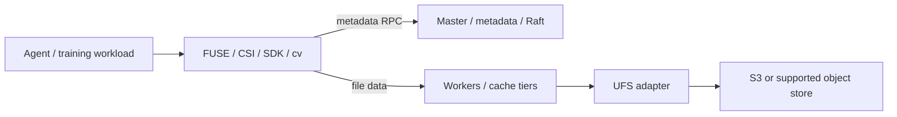

# Runix FS architecture baseline

Baseline: Curvine `7d476508e2cd608a1aaaf7837999f52ab633811e`.
Evidence is source inspection, not production runtime validation.

## Module map

| Area | Source | Responsibility |
| --- | --- | --- |
| Workspace | `Cargo.toml` | Rust crates; default-members omit integration harness and LanceDB |
| Contracts | `crates/common/curvine-{fs,storage,ufs}-api` | Interface boundaries between clients, storage and UFS |
| Core | `crates/core` | Runtime, networking, RPC, I/O, allocation, metrics and fault injection |
| Metadata | `curvine-master`, `curvine-mds`, `crates/metadata/curvine-raft` | Namespace/metadata services and replicated state |
| Storage | `curvine-worker`, `crates/adapters/curvine-storage-*` | Data serving, local cache and optional SPDK adapter |
| Object store | `crates/adapters/curvine-ufs-opendal`, `curvine-ufs` | Underlying storage including S3 through OpenDAL |
| Clients | `curvine-client`, `crates/client` | Metadata RPC, direct worker data access, unified filesystem and jobs |
| POSIX | `curvine-fuse` | FUSE operations, uid/gid/mode permissions and kernel mount options |
| SDKs | `curvine-libsdk`, `crates/sdk` | Native SDK with Java/Python integration |
| Kubernetes | `curvine-csi` | Separate Go CSI controller/node implementation and deployment examples |
| Vector data | `curvine-lancedb` | Optional LanceDB integration; heavy Arrow/Lance dependencies |
| Operations | `curvine-web`, `etc/grafana`, `build/bin` | Dashboard/API, metrics, cluster scripts |
| Tests | `curvine-tests`, per-crate tests | Unit, cluster, fault injection, regression and benchmarks |

## Request and durability path



Metadata routes to the master; bulk data flows to workers. The object store is
an underlying backend. Cache-mode and filesystem-mode durability differ:
cache-mode writes through, while filesystem-mode can acknowledge before
asynchronous UFS persistence. Define and test checkpoint durability, pending
writes, retries and recovery before promising backup or loss guarantees.
Master metadata recovery and restoring bucket objects are distinct operations.
See `crates/client/curvine-unified-fs` and `curvine-master` when specifying writes.

## Existing features versus commercial boundaries

- `curvine-fuse/src/fs/curvine_file_system.rs` checks POSIX permissions and
  `crates/common/curvine-config/src/fuse_conf.rs` configures permission checks.
  Client/kernel uid/gid/mode behavior is not authenticated cloud tenant isolation.
- `curvine-master/src/master/quota/quota_manager.rs` manages cache capacity/eviction;
  it is not a subscription balance or tenant billing ledger.
- `curvine-csi/pkg/csi/controller.go` accepts requested PVC capacity and
  provisions directories; returning capacity is not proof of enforced byte quota.
- Transfer-job tenant fields exist in the transfer service. Caller-provided
  tenant labels are not sufficient evidence of authentication/authorization.
- The inspected `curvine-web` listener installs tracing/error handling, and the
  master router exposes config/browse/administrative operations. Keep these
  services private until an authenticated service boundary is implemented and
  independently verified. Do not expose an upstream dashboard as a SaaS console.
- The upstream README advertises S3 protocol compatibility. The inspected
  workspace proves an S3 **backend** adapter; a runnable customer-facing S3
  gateway was not established. Treat such a gateway as unverified scope.
- Metrics establish observability, not billable, durable, deduplicated usage.
  Add a separate accounting pipeline if metered sales are introduced.

These findings identify design gates, not a claim that a deployed upstream
service has been penetrated or that every potential implementation is absent.

## Development and test gates

Read `rust-toolchain.toml` (pinned channel 1.98), `Cargo.lock`, Makefile and
`.github/workflows/build.yml` together. Native dependencies include RocksDB,
protobuf tooling, compiler/linker and optional JVM/HDFS/FUSE dependencies. Use
the upstream Linux build containers or a documented equivalent environment.

```sh
cargo metadata --no-deps --format-version 1
cargo fmt --check
make check-client-deps
make check-api-crate-deps
cargo test --locked -p curvine-fault --features fault-injection
# Full engine gates on Linux with FUSE/native dependencies:
cargo test -p curvine-tests --features fault-injection --test replication_test -- --test-threads=1
# Follow the inherited compile workflow for build, cluster and POSIX smoke.
```

Default `cargo test` omits intentionally opt-in workspace members, and a small
crate test does not prove POSIX compatibility, CSI isolation or failover. Before
engine releases, execute the explicit integration harness, FUSE create/read/
write/rename/delete/fsync, restart/recovery, UFS failure/retry and CSI lifecycle
tests, then produce Runix-specific performance measurements.
