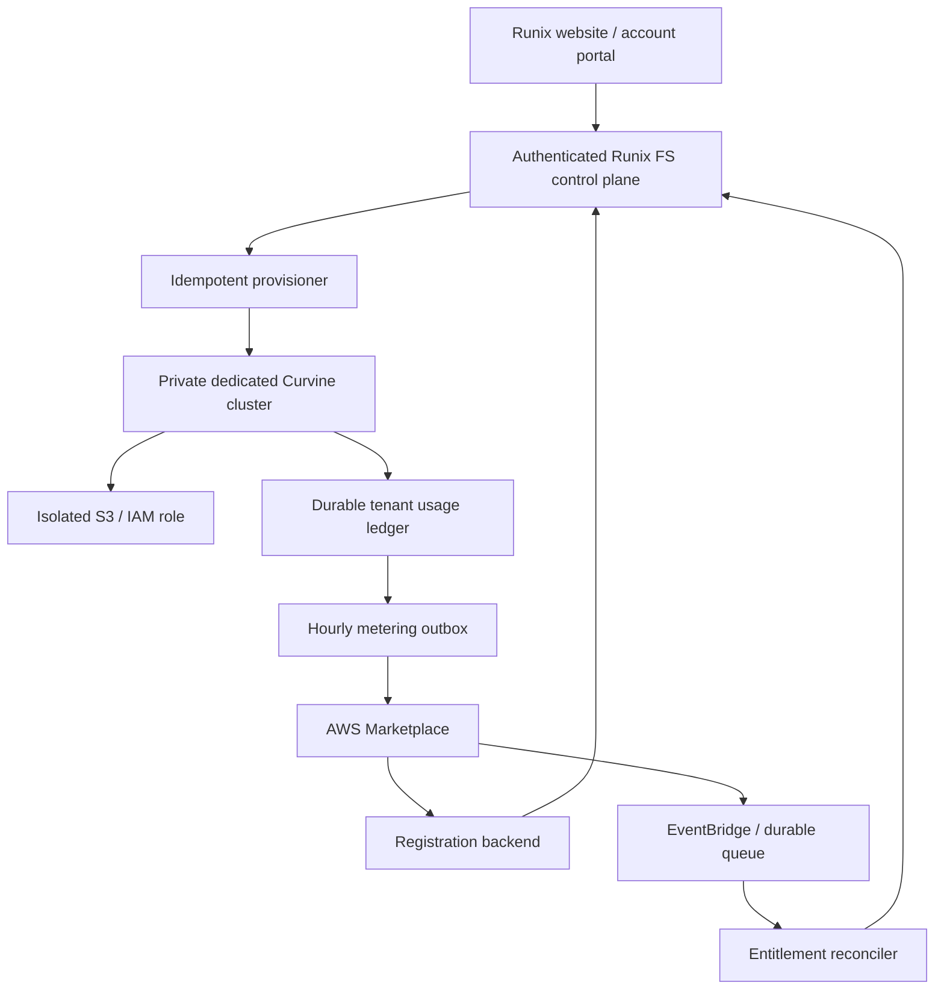

# AWS commercial service design

Status: design contract plus an offline-tested AWS adapter. A non-public Staging
product was created on 2026-10-23; see marketplace-listing.md. No commercial HTTP
API, paid cluster or billing integration is deployed. Baseline official sources
were retrieved on 2026-10-21; listing notes record the 2026-10-23 refresh.

## Product and charging models

Subscription is a charging model; SaaS is a delivery model. They can coexist.
Separate the deployment decision from the AWS Marketplace pricing decision:

| Offering | Deployment | Commercial path |
| --- | --- | --- |
| Open-source Runix FS | Customer operates cluster | Apache-2.0 code, no mandatory online license check |
| Supported dedicated deployment | Customer AWS account or isolated seller environment | Fixed-term service/support contract; select the appropriate listing model after validating delivery eligibility |
| Managed Runix FS SaaS | Runix-operated private data plane | SaaS Contract for committed capacity, SaaS Subscription for usage, or Contract with pay-as-you-go |

Initial recommendation: dedicated managed clusters with fixed contracted
capacity and explicit hard limits, then optional metered overage. This reduces
the initial shared-cluster isolation surface and makes cost exposure easier to
control. It is a design recommendation, not a selected AWS listing or approved
price. A BYOC deployment does not automatically qualify as SaaS: review the
actual service ownership and Marketplace product requirements before listing.

AWS uses **SaaS Subscriptions** to mean pay-as-you-go metering. Fixed recurring
monthly/yearly commercial plans usually map to **SaaS Contracts**. Contract
with pay-as-you-go supports both commitment and metered excess. Pure Contract
checks entitlements and does not submit usage for billing. AWS states that the
pricing model cannot be changed after a listing is published to limited; settle
that choice before publishing. Avoid creating two listings merely because
"subscription" and "SaaS" were mentioned as two business models.

## System boundaries

Keep AWS registration, payments and billing SDK calls outside file read/write
hot paths. The control plane decides resource access and capacity; engine RPC
and workers remain private. Expose supported operator actions through an
authenticated backend with an allowlist and audit log.

Initial AWS delivery: separate customer deployment boundary, private subnets,
restricted security groups, three masters across failure domains when HA is
required, workers sized by measured cache demand, explicit S3 ownership, KMS,
least-privilege runtime IAM roles, encrypted backup and restore tests. EKS/CSI
is appropriate for Agent pods; validate kernel/FUSE privileges and actual PVC
lifecycle before advertising it. No AWS resources are provisioned here.

## Registration and entitlement

New integrations must use `CustomerAWSAccountId` and `LicenseArn`. Official
ResolveCustomer documentation says `CustomerIdentifier` is not populated for
new SaaS integrations; an AWS account can have concurrent agreements. Model a
Runix organization separately from AWS accounts, products and granted licenses.

1. Receive the registration POST on a backend, redeem its token immediately
   with ResolveCustomer in the seller account, and verify the ProductCode
   against the expected listing. Never log the raw token.
2. Persist `(CustomerAWSAccountId, LicenseArn, ProductCode, AgreementId)` where
   available. Bind the agreement only after authenticated organization ownership
   checks. Enforce unique license binding and replay/idempotency constraints.
3. For Contract offerings, page through GetEntitlements by license/account and
   dimension; empty pages may still have NextToken. ResolveCustomer success
   establishes identity, not a paid capacity entitlement. For Subscription
   offerings use the appropriate agreement/license activation lifecycle; do not
   require nonexistent Contract dimension entitlements for pay-as-you-go.
4. Create resources only after the relevant verified active license/entitlement.
   Record `PENDING_MARKETPLACE -> ENTITLEMENT_VERIFIED -> PROVISIONING -> ACTIVE`.
   Track failure, suspension and expiry explicitly; duplicate events never
   create duplicate clusters or capacity grants.
5. Reconcile periodic AWS state in addition to processing events. Reject stale
   event versions and make suspend/resume idempotent. Define export/retention
   rules before terminating access; subscription expiry must not delete data.

For sellers registered after **July 15, 2026**, AWS states that new sellers
receive SaaS lifecycle events through EventBridge rather than SNS. The seller
registration date and existing integration are not verified here; use the new
EventBridge path for this design and validate the actual account at onboarding.
The current subscription guide allows one hour for remaining metering after an
agreement ends, before license deprovisioning. Store the event and deadline and
prioritize the final durable usage flush.

The 2026-10-23 EventBridge guide instead describes license deprovisioning as the
start of the one-hour window. This conflicts with the subscription guide above.
Do not implement PAYG cancellation against either assumption until the applicable
AWS integration lifecycle is confirmed. Stop accumulating new charges at known
cancellation; never use the ambiguity to extend billable access.

## Usage, limits and billing

Select a small number of explicit dimensions after cost measurements, such as
provisioned cache capacity-time or dedicated node-time. These are candidate
dimensions, not current prices. Define decimal/binary capacity units, sampling
intervals, rounding and UTC billing periods before implementation. Integer AWS
quantities require a documented aggregation unit; aggregate first and round
once per dimension-period, never once per request. Separate S3/EC2 charges paid
by the customer from the seller's software/service charge.

Maintain three distinct records:

1. Durable per-tenant resource/usage truth with source identity and timestamp.
2. Immutable metering batches, status, attempt history and AWS record IDs.
3. Reconciliation to AWS settlement/invoice data.

For new Concurrent Agreements integration, BatchMeterUsage records carry
`CustomerAWSAccountId` and `LicenseArn`. Omit request-level `ProductCode`;
AWS explicitly warns that sending both product-based and license-based records
for the same customer/hour can cause duplicate billing. The API reference says
new products have required the new identifiers since **June 1, 2026**. Product
identity remains in the local mapping and registration checks.

Use a durable outbox and a unique aggregation identity including license,
dimension and UTC period. Freeze each submitted quantity; retry identical
records without generating a new charge. Retry UnprocessedRecords, distinguish
successful/duplicate/rejected records, and quarantine permanent errors. A 200
response alone does not prove every record was billed. Keep usage on disk before
worker restart, reconcile gaps and prevent cross-tenant allocation.

Current BatchMeterUsage limits: up to 25 records, under 1 MB per request, and
records must be less than 24 hours old. A previous billing month's records have
a separate first-day **06:00 UTC** cutoff. Submit hourly and alert well before
either deadline. The tighter unsubscribe/deprovision window also applies.
Recheck these limits when implementing instead of copying older six-hour
submission assumptions from historical architecture notes.

Overage must default to off until the customer explicitly chooses it. A local
atomic capacity reservation/hard limit enforces the service contract; billing
alerts and upstream cache eviction do not enforce a spending cap. Never do
synchronous Marketplace calls in storage operations. Define read/export access
under exhausted capacity separately from new allocations and writes.

Expose `Estimated` for locally computed cost, `Pending` for submitted usage,
and `Final` only after AWS billing reconciliation. An accepted metering record
is not an issued AWS invoice. Do not invent final customer amounts.

## Required tests before commercial activation

- Registration: invalid/expired/replayed tokens, unexpected product, wrong
  account, concurrent license binding and account takeover attempts.
- Entitlements: pagination including empty pages, expired/stale state,
  multiple simultaneous agreements, duplicate/out-of-order events, restart.
- Provisioning: crash after capacity reservation and after resource creation,
  duplicate requests, rollback and eventual cleanup without data deletion.
- Authorization: cross-tenant namespace, Worker direct access, CSI PV boundary,
  POSIX uid/gid manipulation, credential revocation and operator auditing.
- Quotas: concurrent writes/reservations, stale reads, failure/refund behavior,
  bounded unreported usage, and continued permitted export.
- Metering: identical replay, partial batch success, unprocessed retry,
  account/license mapping, UTC month boundary, rounding, late data,
  unsubscribe flush, prohibition of legacy/new double submission.
- Recovery: S3 retry, master/worker restart, Raft recovery, metadata plus journal
  backup/restore, crash with pending async writes, FUSE and CSI smoke.

All new backend endpoints require unit tests. Money/entitlement/quota code
requires an independent adversarial review and seller test-account integration
before any paid activation. Publication and real charges require owner approval.

## Official references

- Pricing models: https://docs.aws.amazon.com/marketplace/latest/userguide/saas-pricing-models.html
- Subscription lifecycle: https://docs.aws.amazon.com/marketplace/latest/userguide/saas-subscriptions.html
- Contract pricing: https://docs.aws.amazon.com/marketplace/latest/userguide/saas-contracts.html
- ResolveCustomer: https://docs.aws.amazon.com/marketplacemetering/latest/APIReference/API_ResolveCustomer.html
- GetEntitlements: https://docs.aws.amazon.com/marketplaceentitlement/latest/APIReference/API_GetEntitlements.html
- BatchMeterUsage: https://docs.aws.amazon.com/marketplacemetering/latest/APIReference/API_BatchMeterUsage.html

AWS documentation contains legacy fields alongside new-integration notes. The
new-integration rules above take precedence for this planned product; confirm
the live SDK model and listing's integration generation during implementation.

## Implemented adapter boundary, 2026-10-23

`scripts/runix/marketplace_adapter.py` provides `ContractGateway.from_session`
using one caller-provided boto3 Session with its normal credential chain, in
us-east-1. It verifies the caller's seller account with STS before Marketplace
calls. It redeems registration tokens, requires account, product, license and
Metadata.AgreementId, and verifies a positive integer Contract entitlement by
product/account/license/dimension with bounded pagination and explicit expiry.
AWS errors, missing metadata, unknown identities and ambiguous grants deny access.

This adapter has no HTTP listener, login, organization binding, storage, events,
provisioning or metering. It does not authorize a browser user merely because a
registration token resolves. Returned quantities are current verification
results, never additive capacity grants. Replays of reads do not allocate
anything. A future service must provide a durable unique license binding,
freshness policy, authenticated organization ownership and atomic reservations.
No claim of completed organization authentication or replay-safe provisioning
is made by these SDK tests.

Install `scripts/runix/requirements-marketplace.txt` into an isolated environment
and run `python -m unittest discover -s scripts/runix -p test_marketplace_adapter.py -v`.
Tests use actual botocore 1.43.118 models and Stubber, not real purchases. The
SDK model includes LicenseArn, Metadata.AgreementId and the LICENSE_ARN filter.
No CustomerIdentifier dependency or BatchMeterUsage invocation is introduced.
